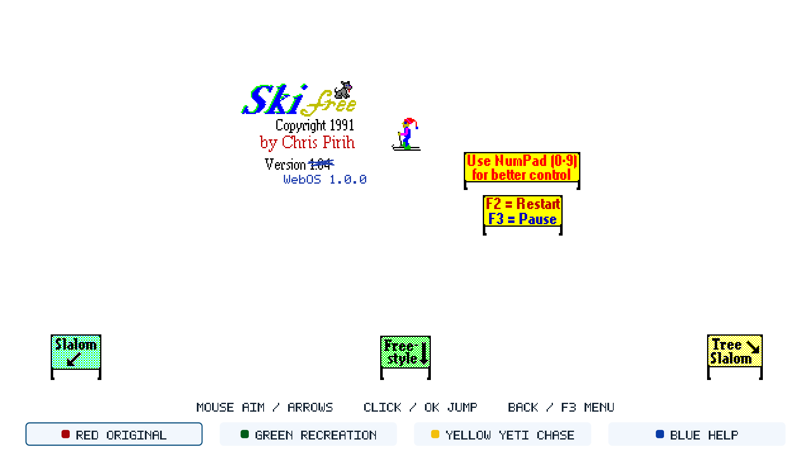
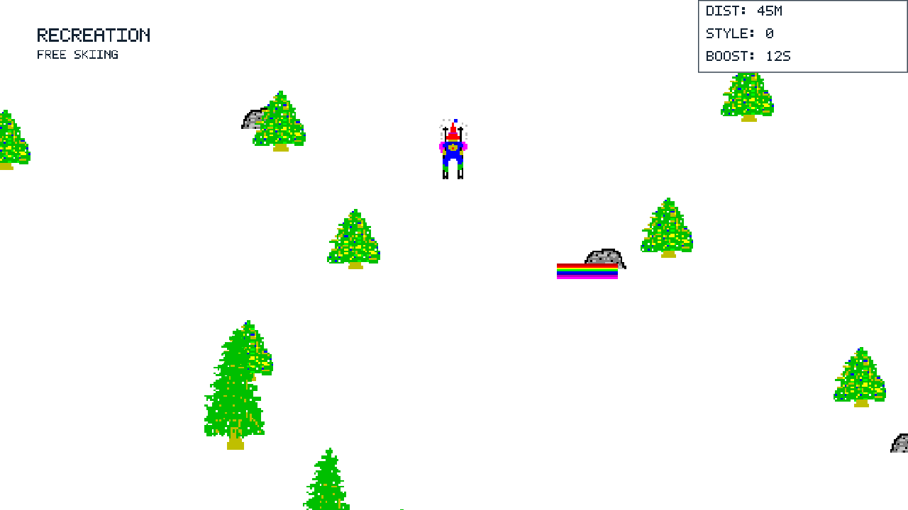

# SkiFree for webOS

[](release/TAGGING.md)
[](docs/INSTALL.md)
[](native/README.md)
[](native/docs/WEBOS-RUNTIME.md)
[](native/docs/VERIFICATION.md)
[](native/NOTICE.md)

A free, independent adaptation of SkiFree for LG webOS TVs. Play with a Magic Remote, mouse or keyboard. Original game and artwork by **Chris Pirih**. This is a free fan release; no royalties or payments are requested, and original rights remain with their owners. See [notices](native/NOTICE.md).



*Native 1.0.0 framebuffer captured on an LG C3. Original is the default run.*

**[Install and play](docs/INSTALL.md)** · [Controls](#original-controls) · [Compatibility and checks](native/docs/VERIFICATION.md)

**Release status:** 1.0.0 is verified on the owner's C3. Download it from the [GitHub release](https://github.com/ryanspice/SkifreeWebOS/releases/tag/v1.0.0); no Homebrew Channel listing has been published yet. Do not install a copy from an untrusted mirror.

**Next: [1.1.0 — optional online high scores](docs/ROADMAP-1.1.0.md).** Planned:
an opt-in leaderboard, an Off setting and reliable offline play. Online scores
are not part of this 1.0.0 build.

## Release brief

Original preserves the reconstructed 1.04 mountain, courses, characters and rules.
The separate Recreation and Yeti Chase runs add simplified steering and boosts.
This release adds a lighter Recreation HUD, hides the footer while skiing and
lets qualifying Original scores carry three initials, starting at **AAA**.

The release executable is byte-identical to the package verified on the LG C3;
that build kept saved Slalom and Freestyle records across a fresh session and a
package update. **Back → High Scores**
opens the three saved course tables. Original’s status box stays hidden on the
opening screen, then shows live course statistics and the saved **BEST** record
after you start skiing downhill.
[Build and acceptance details](native/docs/VERIFICATION.md).

## Install on your TV

1. Get the **ARM IPK and its SHA-256** from the
   [1.0.0 release](https://github.com/ryanspice/SkifreeWebOS/releases/tag/v1.0.0),
   or build it by following the [TV build brief](docs/TV-BUILD.md).
2. Set up your TV with [LG Developer Mode](https://webostv.developer.lge.com/develop/getting-started/developer-mode-app)
   and the webOS CLI. This is the route used for the C3 tests. The package verified there
   was installed and launched as a non-root app. [Rooted and unrooted notes](docs/COMPATIBILITY.md).
3. Verify and install the supplied package, replacing `my-tv` with your CLI device:

   ```powershell
   Get-FileHash -Algorithm SHA256 .\com.ryanspice.skifree_1.0.0_arm.ipk
   ares-install --device my-tv .\com.ryanspice.skifree_1.0.0_arm.ipk
   ares-launch --device my-tv com.ryanspice.skifree
   ```

Original opens automatically. Aim with the pointer or directional keys and press
OK to jump. **Back** opens the menu. Developer Mode expires; see the
[full installation guide](docs/INSTALL.md) for setup, checksums, session upkeep
and score troubleshooting.

**Known 1.0.0 issue:** in some nested menus/dialogs, the first **Back** press opens
the exit confirmation instead of canceling the current dialog. Cancel and press
**Back** again. It does not affect gameplay or score saving; a later release will
fix it.

| At a glance | Current status |
| --- | --- |
| TV target | LG C3 / OLED48C3PUA, firmware 43.21.84, webOS 11.2.0 |
| Minimum webOS release | **11.2.0** tested; no claim below it |
| Native runtime | ARM32; GLIBC 2.38 and GLIBCXX 3.4.32 required |
| Controls | Magic Remote pointer and directions, mouse, keyboard |
| Saved scores | Original top ten per course, three-letter initials, legacy import |
| Other TVs and webOS releases | Theoretical only. The C3 at 11.2.0 is the only tested configuration; no support claim below 11.2.0. |
| Tag and downloads | [GitHub release](https://github.com/ryanspice/SkifreeWebOS/releases/tag/v1.0.0) · [tag checklist](release/TAGGING.md) |

1.0.0 is a single-TV release. The measured minimum is 11.2.0. Other models and
older webOS versions are theoretical targets for later testing; do not treat them
as supported.

## Choose your run

- **Original** follows the reconstructed SkiFree 1.04 rules: Slalom, Tree Slalom and Freestyle on the original mountain, with its original characters, scoring and fast-mode toggle. The yeti appears during ordinary play, including beyond 2,000 metres downhill.
- **Recreation** offers free skiing with simplified steering, timed boosts and aerial tricks.
- **Yeti Chase** is Recreation's pursuit mode, with a head start and room to recover after a fall.

Original is the default. **Red** selects Original, **Green** selects Recreation, **Yellow** selects Yeti Chase, and **Blue** opens help, which lists the controls. Click the on-screen choices or use **Back → Choose a Run**. Keyboard F5–F8 provide the same shortcuts. Switching preserves each run until the app closes.

The on-screen colour strip and footer hints stay hidden during skiing. Remote colours and F5–F8 still work; opening the pause menu brings the choices back. Original's stationary opening screen retains its controls.

Version **1.0.0** keeps the original lift sprites and opening credit, with the original 1.04 crossed out above **WebOS 1.0.0**. Score files are validated before loading or replacing, and menus show a warning if high scores cannot be saved. All 89 original bitmap resources are included; no import, account or payment is required to play. The Windows executable is neither included nor run.



*Recreation's updated native desktop view: compact white status panel and no in-run footer. Its simplified rules and gentler pursuit are separate from Original.*

## Original controls

| Control | Action |
| --- | --- |
| Mouse / Magic Remote pointer | Aim the skis using the original mouse direction logic |
| Mouse click / remote OK | Original mouse jump or airborne trick; restart after being eaten |
| Arrows / directional pad | Original turning, downhill and uphill stepping directions |
| Insert / numpad 0 / Space | Original smaller keyboard jump |
| f | Toggle original fast mode; repeats and letter case follow the EXE |
| Enter | Desktop: restart only after being eaten; on webOS Return also serves remote OK |
| F2 | New game |
| F3 / Back / Escape | Pause or resume; pause menu includes fast mode, help and exit |

<details>
<summary>Additional original keyboard commands</summary>

- **t / r:** single-step / redraw.
- **x / X / y / Y:** two-pixel right / left / downhill / uphill nudges.
- Letter commands retain the original case-sensitive behavior. The fast toggle is lowercase **f**.

</details>

The top-right status box is hidden on the opening screen. Once you ski downhill,
it identifies the active course and separates **LIVE** time/style values from
the course’s saved **BEST** initials and result. **BEST: --** means no record is
available for that course; free skiing has no ranked table.

**TIME** is the original race clock: it starts at the Slalom or Tree Slalom start line, excludes pauses, includes five-second missed-gate penalties, and freezes at the finish. Free skiing and Freestyle do not start a new race clock.

Keyboard input takes control until the pointer moves again. Focus loss pauses the game; returning does not silently resume it. The pause menu makes F-key functions available on a remote.

The status font, pause/help dialogs and local high-score storage are adapted for the TV. This is a reconstruction-based adaptation, not a claim of proven byte-for-byte equivalence. Read [provenance and limits](native/src/classic/PROVENANCE.md) and [verification](native/docs/VERIFICATION.md).

## Recreation and Yeti Chase controls

Move the pointer or use **Left / Right** to steer. **Up** brakes; **Down** points downhill. **OK / click / F** boosts while skiing or performs a trick while airborne. The HUD shows when the boost is ready again. After a run ends, **OK / click** restarts. **Back** opens the menu, including **Resume and Boost**.

These controls and the gentler pursuit apply to Recreation and Yeti Chase. Original retains its own movement, jumps, fast toggle and yeti behavior.

## High scores

Finishing an Original course opens its high-score table. Slalom and Tree Slalom rank lower times first; Freestyle ranks higher style scores first. A qualifying result first opens a classic three-letter initials screen, starting at **AAA**.

Type three letters and press **Enter**, or use **Left / Right** to select a letter, **Up / Down** to change it, and **OK** to advance to **Save Initials**. Pointer users can click the plus/minus buttons and **Save Initials**. **Back** keeps the current letters and shows the table. The result is saved automatically with its current initials; nonqualifying results skip entry.

Existing scores import with **---** where no initials were recorded. The TV package
stores named scores in writable application state and leaves the old
installation-root files in place. It checks that saving works at startup. This is a TV
score-entry adaptation; Original's ranking, penalties and course rules are unchanged.

Reopening starts at the original mountain. Open **Back → High Scores** at any
time to view saved entries. **Left / Right** changes between Slalom, Tree Slalom
and Freestyle; pointer users can click the course buttons. **Back** returns to
the pause menu. Each course has its own table; Recreation and Yeti Chase do not
add scores to these tables. If a menu says **High scores are not being saved**,
see [score troubleshooting](docs/INSTALL.md#scores-and-troubleshooting).

## Build and release

[Contributing](CONTRIBUTING.md) · [Security](SECURITY.md) · [Code of conduct](CODE_OF_CONDUCT.md) · [Documentation map](docs/README.md) · [Repository review](docs/REPOSITORY-REVIEW.md)

[TV build brief](docs/TV-BUILD.md) · [Compatibility research and synthesis plan](docs/COMPATIBILITY.md) · [Tag preparation](release/TAGGING.md)

[Release walkthrough: GitHub → Homebrew](docs/RELEASE-GUIDE.md) · [Visual tutorial](docs/RELEASE-WALKTHROUGH.html)

[Native build instructions](native/README.md) · [Release preparation](release/README.md) · [1.0.0 notes](release/RELEASE-NOTES-1.0.0.md) · [Local visual review](native/docs/VISUAL-REVIEW-1.0.0.md)

C++20 and GLES2 draw the game; SDL2 supplies the window and input. App ID: `com.ryanspice.skifree`. Homebrew publication and social posts remain drafts. The new platform code's MIT license does not cover the original resources or reconstructed core. This free fan release asks for no royalties or payments; no upstream license grant is recorded. See [notices](native/NOTICE.md).

The [original-game comparison](native/docs/ORIGINAL-COMPARISON.md) records the checked executable resources and reconstruction functions. The Windows executable is the behavioral reference for Original; the [parity contract](native/docs/ORIGINAL-PARITY.md) identifies the TV presentation and input adaptations.

## More from Ryan

[Website](https://ryanspice.com/) · [GitHub](https://github.com/ryanspice)

Build, automated tests, TV execution, physical controls and owner acceptance are recorded separately in [verification](native/docs/VERIFICATION.md).
