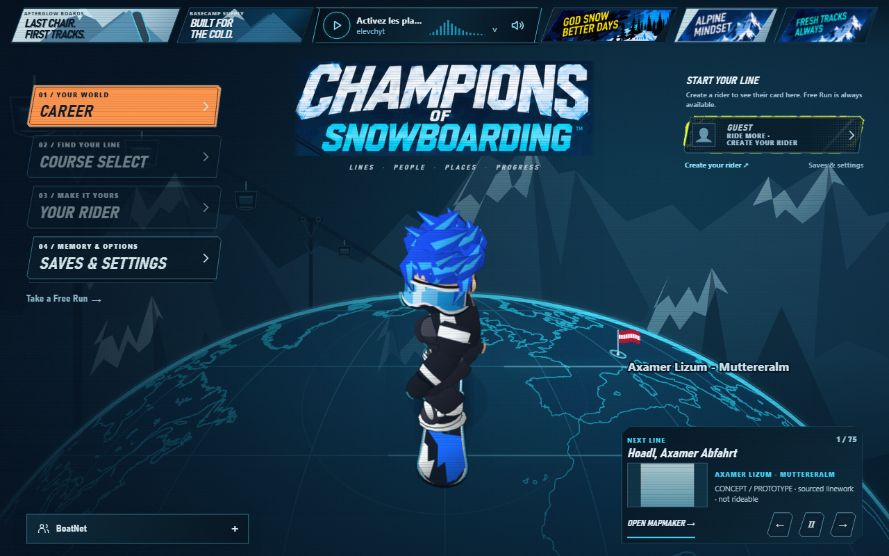

# More from Ryan

Thanks for playing SkiFree for webOS. It's free, with no paid unlock or account required to play. Chris Pirih created the original SkiFree and its artwork; this is my independent TV adaptation.

[Visit my website](https://ryanspice.com/) · [Follow my work on GitHub](https://github.com/ryanspice)

## Champions of Snowboarding 2026

**Another mountain. A snowboard this time.**

*Development interface captured October 15, 2026. The course panel contains concept linework; this is a work-in-progress interface preview, not gameplay footage or a release announcement.*

I'm also building **Champions of Snowboarding 2026**. If SkiFree brought you here, take a look at the snowboarding game I'm working on next.

**[Follow my work at ryanspice.com](https://ryanspice.com/)**

Champions is my own separate game. This is a promotion from its developer, with no claim of affiliation with SkiFree or its author.

## Help with SkiFreeWebOS

Useful reports include your TV model, exact firmware/webOS release, app version, input device and the steps that reproduce a problem. Please keep original executable files, private network addresses, credentials and unrelated TV logs out of public issues.

## Support my work

If you'd like to support more projects like this, [visit my website](https://ryanspice.com/). Sharing the project and reporting reproducible bugs help too. Thanks for playing.
