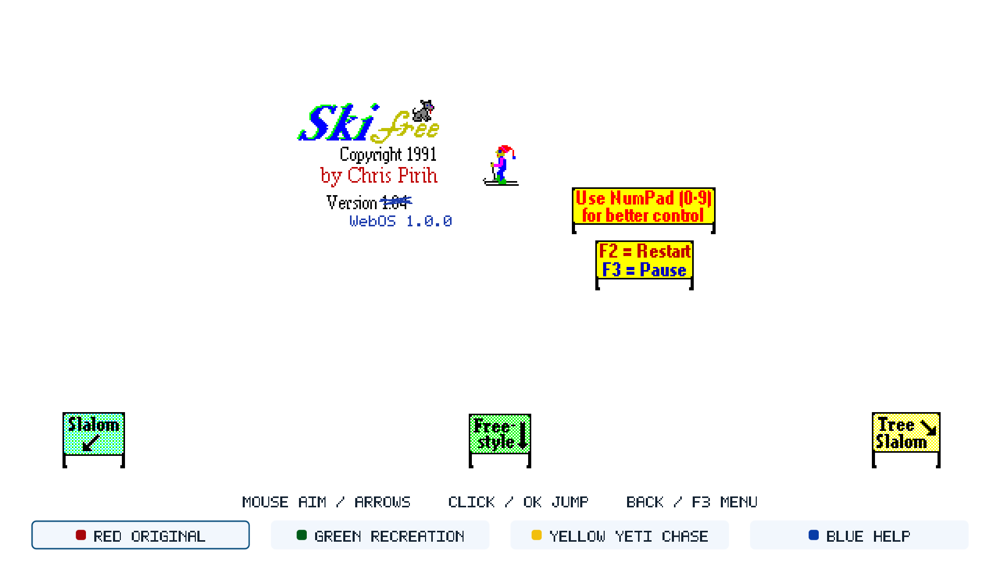

# Verification — SkiFree for webOS 1.0.0

Updated November 9, 2026. This record separates automated checks, physical-device observations and human feedback. It is not a claim of exhaustive equivalence to the Windows executable.

## Status on November 9, 2026

- **Release package:** `com.ryanspice.skifree_1.0.0_arm.ipk`, **3,033,540 bytes**, SHA-256 `b2aae0695f7818dfc939ee04a96373045e9e0a22a6e88f12f18bfed5b36a7450`; ARM executable `ed646651…`. It was installed and launched through Developer Mode on the C3 on 2026-11-09. It reuses the executable from the earlier C3-verified package (`494726b3…`, 1,999,474 bytes) and adds the current notices. The executable contains the initials and named-score markers.
- **Earlier C3-verified package:** SHA-256 `494726b3…` (1,999,474 bytes; the same `ed646651…` executable). Owner-confirmed Slalom and Freestyle records survived a fresh launch and a package update. Its non-root score-file creation/replacement and empty-table preservation were checked.
- **Storage-fix package:** SHA-256 `e7b3d649…` (1,989,972 bytes; ARM executable `60397dfc…`). It was launched as non-root UID 6252, and score-file creation and replacement were checked. See *Historical November 5 non-root score storage fix*.
- **Source:** the final release commit is recorded in `RELEASE-MANIFEST.json`. No gameplay source changed after the `494726b3` package; the release IPK is a repack with the current notices, not a new compile.

The repackaged IPK's install and launch are recorded below. Its score file was not independently re-inspected after this install; the non-empty, non-root and update evidence applies to the byte-identical executable from the earlier package.

## Current package: saved-score browser and course-aware HUD

The owner confirmed that the two records found on disk were the expected results.
A fresh launch independently loaded one Slalom and one Freestyle entry, with no
Tree Slalom entry. This resolved the apparent session loss: tables were separate
per course and the old interface only showed a table after another finish.

The pause menu now includes **High Scores**, with pointer buttons and Left/Right
navigation across all three Original tables. Browsing pauses gameplay, suppresses
the current-run marker and returns to the menu without changing the records.
Original's top-right panel is hidden until downhill movement begins; it then
identifies the active course, LIVE statistics and a separate saved BEST result.
The clock displays a live race time only for the timed courses. Restarting hides
the panel again. These are presentation adaptations; the simulation is unchanged.

Release package SHA-256:
`b2aae0695f7818dfc939ee04a96373045e9e0a22a6e88f12f18bfed5b36a7450`
(3,033,540 bytes). ARM executable SHA-256:
`ed646651be25509a7e04ac00cd9f66c76bc15dd9444e8172c486fac6e3075613`.
The executable is byte-identical to the earlier C3-verified package (`494726b3…`).
It is installed on the C3. The earlier package's real records survived its update
byte for byte, and the new process loaded counts `[1,0,1]`; the old numeric file is
also unchanged. This establishes non-empty relaunch and one package-update path on
that configuration, not uninstall, UID-change or all-upgrade survival.

All **83 native UI cases** passed for the executable, including two processes
sharing the same score path, browser course switching/return/empty states, paused
race timing, hidden intro/restart HUD and the saved-best row during a real Slalom
entrance. Captures were inspected. Four Linux suites and four Linux ASan/UBSan
suites also passed for the unchanged gameplay/storage core. The earlier Windows
Debug four-suite result remains separate evidence. The release ARM stage/IPK audit
matches all **104 staged / 105 packaged files**; the 89 original sprites and core
are unchanged.

The public README image is a C3 opening capture showing the hidden status panel.
The 1.0.0 tag and GitHub release are public. The 2026-11-09 install/launch used the
release IPK; a new screen capture was blocked by the TV's `/tmp` permissions, so
this pass records launch evidence without a new screenshot.

## Historical November 5 non-root score storage fix

The owner corrected the earlier score-survival response and reported **High scores
are not being saved**. That warning is recorded as a real defect in the November 4
package, not a root requirement. Its SDL webOS preference path was the root-owned
installation directory. The non-root app could read the legacy file, but could
not create the temporary file required for a safe save.

The corrected package provides a root-owned sticky `state/` parent (01777), then
creates a per-runtime-UID child for scores and diagnostic receipts. Only this
data parent is writable; executable, asset and library modes remain restricted.
Old named/numeric tables are imported in that order and preserved. Startup now
performs a real save of the validated table before reporting saving as available.

Package SHA-256: `e7b3d6495e48e8cfd1307e6f47542947cb0ec4ebbaf3f09d1254a58eb5e165de`
(1,989,972 bytes). ARM executable SHA-256:
`60397dfc0b45e9546670745c5532c5b5033d23e45351dfd112febe80e63bee50`.
It was installed and launched through Developer Mode on the observed C3, running
as UID 6252 with no root service. Its new score file is owned by UID 6252, and
creation plus replacement after close/relaunch were verified. The file's
timestamp advanced, its format remained valid and no temporary file remained.
The old 13-byte numeric table's hash stayed unchanged. The initial table is empty;
this is not a human-earned result or a non-empty migration test.

Fresh checks passed: four Windows Debug suites on the freed B: volume, four Linux
host suites, four Linux ASan/UBSan suites, **68 native UI cases**, six source-boundary
tests, seven stage-boundary cases and six package-permission tests. The SDK audit
has 12 records; all 104 staged / 105 packaged files match, including 89 sprites
and one state-directory README. Original simulation and artwork are unchanged.

The requested independent AI review of this fix found one release-verifier gap:
hashes alone accepted writable or non-root-owned code/assets. The verifier now enforces
root ownership and exact file/directory modes, with only the sticky state parent
excepted. Six permission tests pass, including six metadata-only tampering cases;
the peer's unsafe fixture is rejected and the installed IPK still passes unchanged.

The corrected build is open for an earned-score/initials/relaunch playthrough.
Broader input/firmware coverage, non-empty TV upgrade/migration and uninstall
survival remain unverified. Release and tag publication are held while acceptance
of this correction is pending. Raw evidence and preserved originals are in the
project's ignored `.ai/`; the synthesis queue records sources and destinations.

## Historical November 4 release preparation

Three requested independent AI review lanes completed: scoped peer review,
rooted/unrooted research and consumer webOS version research. The peer found two release issues:
the checklist mixed earlier TV evidence with current acceptance, and documentation
source paths were too broadly accepted. The checklist now identifies artifacts;
the source builder explicitly lists approved docs and rejects unapproved credential
and receipt-like text paths. All six source-boundary tests and seven stage cases pass.

The Debug investigation demonstrated a full B: volume, then a fresh parallel
MSVC Debug build on C: passed all four suites without compiler flag changes.
See [Debug diagnostics](DEBUG-BUILD.md). Research conclusions and proposed ABI/SDL
work are in the [compatibility plan](../../docs/COMPATIBILITY.md).

A fresh ARM Release build used the same gameplay source and SDK, with build/stage
outputs on C:. It passed the existing 12-record SDK path/ELF audit, the 103-file
stage audit and the exact 104-file IPK comparison. This is a distinct build with
its own identity; SDK audits do not verify every required symbol against TV
firmware. Package: **1,983,374 bytes**, SHA-256
`b29b9117425001c0700bd23a8a0f00e0386d41db2451ea3de20b607aaedae648`.
ARM executable: `e691bc1eb39e376ac7ab95c7412dd565f2eeafe304618984a9dec1c54dc31efb`.
It is available locally under `native/dist/tv-c3-1.0.0-20261104/` and has not been
installed on the C3. Earlier host UI/sanitizer evidence covers the same unchanged
gameplay sources; it was not rerun as a new physical or firmware compatibility test.

## Historical November 4 HUD and initials build

The current source removes Recreation's dark HUD bar, places its statistics and boost status in a compact white panel, and hides the footer during active runs. Original's stationary opening and menus retain the colour choices. Physical colour shortcuts remain active.

Qualifying Original results now open a three-letter initials screen, starting at AAA. Keyboard letters/Enter, remote-style arrows/OK and pointer plus/minus/save paths pass native UI tests. Back keeps the current letters. Closing or switching away preserves the edited initials, and the default AAA result is persisted before entry begins. The reconstructed Original core and Recreation's game rules are unchanged.

Named scores use `scores-initials-v1.txt`; valid legacy `scores-v104.txt` tables import with --- initials only when the new file is absent. The old file is never rewritten. Invalid or interrupted legacy data blocks migration; invalid new data does not fall back to an older table. Host tests exercise named ranking, ties, migration, rejection, replacement and old-file preservation.

Fresh validation: all four Linux ASan/UBSan suites and all four Windows MSVC Debug suites passed; **67 native desktop UI cases** passed. Captures of the lighter HUD, initials entry, completed table, tenth-place result and failed-save warning were inspected. The ARM32 build and 12-record dependency audit passed, and all 103 staged / 104 packaged files matched. The documentation image of Recreation was updated from the new native capture.

This revised package has **not been installed on the C3**. The TV observations and initial artifact hashes below belong to the earlier 1.0.0 candidate. The revised IPK is SHA-256 `b60075a145641341f99de607f05fc09aacb64762e6986f10c5ba65bac4b9d69e`; its ARM executable is `b06fa50e6d97d08436c03867d37faa61bfb9c8641ca5d316b794d953abab70df`. Physical initials entry and score migration on the TV remain unverified.

## Original gameplay

The core is adapted from the pinned SkiFree 1.04 reconstruction described in [provenance](../src/classic/PROVENANCE.md). The current inventory identifies **67 token-identical shared functions and 22 adapted functions** among 89 shared with the pinned SDL source. Selected direct EXE disassembly supports Tree Slalom start, finish, gate-side comparisons, five-second penalties, interpolation and yeti thresholds. The Original core required no gameplay change during the 1.0 hardening review.

All 89 bitmap resources and 944 bytes across seven reachable game-data ranges were compared against the reference executable. The portable Microsoft CRT random generator matched 4,000 reference outputs across four seeds. [Comparison details](ORIGINAL-COMPARISON.md) and [parity contract](ORIGINAL-PARITY.md) describe the scope and permitted TV adaptations.

Collision, NPC, coordinate-wrap and all other paths were not exhaustively compared at runtime against Windows. Upstream byte-accuracy TODOs remain. The 67/22 inventory is source evidence, not a percentage of proven runtime equivalence. The TV font, dialogs, intro and documented input mappings are adaptations. Recreation and Yeti Chase have separate rules.

## Automated checks

| Check | Recorded result | Scope |
| --- | --- | --- |
| Linux AddressSanitizer / UndefinedBehaviorSanitizer | 118 assertions passed | 70 Original, 15 Recreation, 15 ranking, 18 score-store assertions |
| Original simulation | 72,000 mixed-input ticks covered | Course clocks, crossings, penalties, pause and delayed callbacks included |
| Native desktop SDL/GLES UI | 83 cases passed | Input switching, menus, rendering, save/reload between processes, truncated-file preservation |
| Public-stage boundaries | 7 cases passed | Allowlisted content, altered assets and unexpected files |
| Windows MSVC | Score-store and ranking suites passed | Host filesystem behavior |
| ARM32 build and runtime audit | Passed; 12 dependency records | Target build and library requirements |
| Staged package and IPK | 104 staged / 105 packaged files matched | Extra package metadata accounts for one file; 89 sprite hashes matched; no Windows EXE |

These results belong to the candidate build work. Publication-only documentation edits do not constitute a new run of these suites. The final source addition extended the startup receipt with storage state and score counts; its ARM compile and TV output were checked directly.

Independent static reviews of Original timing/course/yeti behavior, input/lifecycle handling and release evidence found no demonstrated blocking gameplay defect. Static review is not a further test run or physical-TV acceptance.

### Fresh local visual pass

A subsequent strict Linux/WSL Release build passed all four CTest suites and reran all 55 native UI cases successfully. Sixteen additional capture runs brought the set to 71 screenshots, covering all seven application screens and representative gameplay states. The [visual review](VISUAL-REVIEW-1.0.0.md) records the inspected coverage, documentation corrections and one minor Recreation boost-label contrast issue. This pass used Mesa software GLES; it did not rerun sanitizers, rebuild the IPK or operate the TV.

## Physical TV

Tested configuration: **LG OLED48C3PUA (C3), firmware 43.21.84, SDK 11.2.0**. The version information was queried again during publication preparation. The audited IPK installed and launched through the application manager, and its actual framebuffer was inspected at **1920×1080 on Mali-G52 / GLES 3.2**. Installed executable and asset-manifest hashes matched the audited stage.

Close/relaunch was exercised. One immediate sequence briefly left no running app entry; a subsequent launch after closure succeeded. No crash cause was established from that observation. **1.0.0 is a single-TV release:** the C3 is the only tested configuration, and other TV generations are theoretical targets, not backward-compatibility claims. A minimum numeric webOS release or rooted/unrooted requirement has not been verified. See [runtime requirements](WEBOS-RUNTIME.md).

## Human feedback

The owner confirmed all four physical colour buttons in 0.5.0, accepted the gentler Recreation pursuit in 0.6.0, and subsequently reported that the inputs he tested seemed good. This is positive aggregate feedback; it does not enumerate a complete device-by-device input matrix for 1.0.0.

The owner also reported a non-blocking 1.0.0 interaction issue: in some nested menus/dialogs, the first **Back** press opens the exit confirmation instead of canceling the current dialog. Canceling and pressing Back again works. Gameplay and score saving are unaffected; the fix is deferred to a later release.

The local 1.0 candidate follows the owner's release bar: preserve the reconstructed C behavior and intended Original gameplay, with **WebOS 1.0.0** on the intro. Full Windows runtime equivalence remains unclaimed.

## Score persistence

Host tests cover non-empty save/reload, malformed tables, ranking validation, interrupted temporary files and replacement failures. The UI warns when saving is disabled. Existing malformed files and recovery material are preserved. The store does not guarantee concurrent-writer safety or POSIX power-loss durability.

On the C3, an existing empty 13-byte table remained byte-identical through update and close/relaunch. The earlier package's non-root process then created/replaced its own score file, and owner-confirmed non-empty Slalom and Freestyle records survived a fresh launch and the later UI update unchanged. The 2026-11-09 repackaged IPK was installed and launched; its score file was not independently re-inspected. Uninstall, app-UID changes and broader migration routes remain unverified.

## Earlier installed artifact identity and disclosure

| Artifact | SHA-256 |
| --- | --- |
| 1.0.0 IPK, 1,953,364 bytes | `2fc0282c4a924cd6743389bbc8f802af46ae8499b3aafe47d392a0db96dd1e9b` |
| Installed native executable | `17cc6e5dcbaa71b732ce46a0d64888545b80813c8924d47ad16ea4ae908ef396` |
| Asset manifest | `e86293722f01e2a9fb1b3732b87e66ab9512ccb3291acc622feb3467f9ba197e` |
| Original core source | `bf9922eefc15b4af9a715dc38170c7a455cbb270b54637b68859c71e7a91463b` |

Development used substantial AI assistance for implementation, testing, documentation and review. Automated and model reviews do not substitute for meaningful human code review. Original game/artwork and reconstructed code retain separate attribution and rights; the new platform's MIT license does not relicense them. The owner recorded a free, attributed fan-release basis; no upstream license grant is claimed. [Notices](../NOTICE.md).

The source repository and the 1.0.0 GitHub release are public. No Homebrew listing or social post has been published. Future compatibility claims require their own device evidence; Homebrew metadata, human publication review and maintainer acceptance remain separate.
